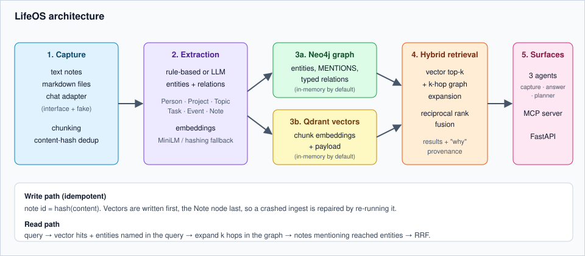
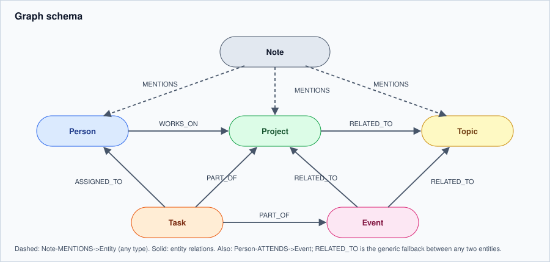
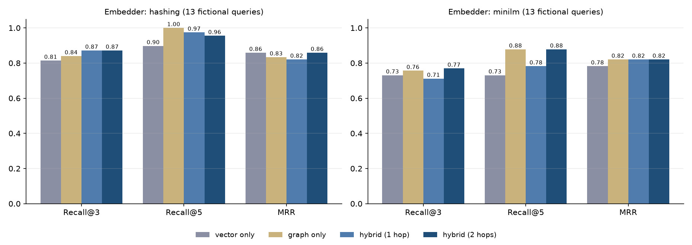

# LifeOS

A personal knowledge engine that combines a **Neo4j knowledge graph** with **Qdrant semantic retrieval**, fed by an ingestion pipeline and queried by tool-using agents, an MCP server and a REST API.


> All data in this repository (notes, people, queries) is **fictional**. "Alex" is a made-up user. The system runs fully offline with in-memory stores, no Docker and no API keys; Neo4j and Qdrant are used when their env vars are set.



## What it does

- **Capture**: text, markdown files and chat messages (adapter interface plus an offline fake) are chunked, embedded and passed through entity/relation extraction (rule-based, or LLM with rule fallback).
- **Store**: entities and typed relations go to a graph (`Person`, `Project`, `Topic`, `Task`, `Event`, `Note`), chunk embeddings to a vector store. Upserts are idempotent (note id = content hash).
- **Retrieve**: vector search plus k-hop graph expansion from entities matched in the query (or in the top vector hits), fused with reciprocal rank fusion. Every result carries a "why was this retrieved" trail.
- **Act**: three small agents (capture/categorise, retrieve/answer, task planner) on a ~40-line tool-calling loop, using the Anthropic SDK (default model id `claude-sonnet-5-5`) or an offline deterministic stub. The same operations are exposed over MCP and FastAPI.

### Graph schema



## Example: a query with provenance

`What is Jonas working on?` (excerpt of [`examples/demo_output.md`](examples/demo_output.md), hashing embedder):

```
4. Garden Bot design (score 0.0253)
   Garden Bot project: a small Raspberry Pi robot that waters the balcony plants ...
   - vector: best chunk #0 cosine=0.05 (vector rank 4)
   - graph: query mentions 'Jonas'; 'Jonas' (mentioned in this note, 0 hops)
   - graph: query mentions 'Jonas'; 'Jonas' <-ASSIGNED_TO- 'Write sensor calibration script
            for the Garden Bot project' (mentioned in this note, 1 hop)
   - fusion: vector rank 4, graph rank 2 -> weighted RRF 0.0253
```

The agent trace for a planning request (stub LLM, real tool calls against the graph):

```
planner agent  input: "Plan the Lisbon Trip"
tool calls: search_memory, get_entity
> Plan for 'Lisbon Trip' from open tasks in memory:
> 1. Book flights for the Lisbon Trip (owner: Maya)
> 2. Reserve an apartment near Alfama for the Lisbon Trip (owner: Alex)
```

## Results

Retrieval evaluation on **12 fictional notes and 13 hand-written queries** (5 lexical, 8 relational), macro-averaged. Reproduce with `python eval/run_eval.py`; full tables in [`reports/eval_results.md`](reports/eval_results.md).

| Embedder | Retriever | Recall@3 | Recall@5 | MRR |
|---|---|---|---|---|
| hashing (offline) | vector only | 0.814 | 0.897 | 0.859 |
| hashing (offline) | hybrid, 1 hop | 0.872 | 0.974 | 0.821 |
| hashing (offline) | hybrid, 2 hops | 0.872 | 0.955 | 0.859 |
| MiniLM | vector only | 0.731 | 0.731 | 0.782 |
| MiniLM | hybrid, 1 hop | 0.712 | 0.782 | 0.821 |
| MiniLM | hybrid, 2 hops | 0.769 | 0.878 | 0.821 |



Read these numbers with care:

- The set is tiny, fictional and written by the author. With 12 notes, top-5 already covers 40% of the corpus. It demonstrates the mechanism and gives a regression harness; it is **not** evidence about real-world quality.
- Defaults (hub damping, seed threshold, graph weight 0.6) were chosen while developing against this same set, so the numbers are optimistic.
- On the 5 lexical queries every retriever scores identically (Recall@5 = 1.0). The differences come from the 8 relational queries. There, 2-hop hybrid beats vector-only on Recall@5 (0.927 vs 0.833 with hashing, 0.802 vs 0.562 with MiniLM), while 1-hop hybrid with MiniLM is *worse* than vector-only at Recall@3 (0.531 vs 0.562) and the gains are not uniform.
- "graph only" still uses vector hits to seed the graph when a query names no entity, so it is not independent of the embedder.

## Quickstart

### Offline (no Docker, no keys)

```bash
uv venv --python 3.12 .venv && uv pip install -r requirements.txt
source .venv/bin/activate

pytest -q                          # 32 tests, no network
python examples/demo.py            # ingest sample notes, hybrid queries, three agents
python eval/run_eval.py            # vector-only vs hybrid evaluation + figure
uvicorn lifeos.api:create_app --factory --port 8000
python -m lifeos.mcp_server        # MCP server over stdio
```

`LIFEOS_EMBEDDER=hashing` forces the deterministic offline embedder; the default `auto` uses `sentence-transformers/all-MiniLM-L6-v2` and falls back to hashing if the model cannot load.

```bash
curl -X POST localhost:8000/notes -H 'content-type: application/json' \
     -d '{"text": "Lisbon Trip is planned with Maya. #travel"}'
curl 'localhost:8000/search?q=who%20is%20going%20to%20Lisbon'
curl localhost:8000/entities/Maya
```

To use the real LLM in the agents, set `ANTHROPIC_API_KEY` (see `.env.example`); `default_llm()` picks it up automatically.

### With Neo4j and Qdrant

```bash
cp .env.example .env     # placeholders; set a real password
docker compose up --build
```

This starts Neo4j 5, Qdrant and the API on port 8000. **Not verified in this environment**: the Docker daemon was not available when this repo was prepared, so the Neo4j store (Cypher) was never run against a live database. The Qdrant store was exercised against Qdrant's embedded in-memory mode only. Treat both server-backed paths as untested until you run `docker compose up`.

### MCP client config

```json
{ "mcpServers": { "lifeos": { "command": "python", "args": ["-m", "lifeos.mcp_server"] } } }
```

Tools: `search_memory`, `add_note`, `get_entity`. The stdio server was smoke-tested with the official `mcp` client (tools listed, a note added and searched).

## Project structure

```
src/lifeos/
  ingest/        chunking, rule-based/LLM extraction, chat adapters, idempotent pipeline
  storage/       GraphStore / VectorStore interfaces; in-memory, Neo4j, Qdrant
  retrieval/     hybrid retriever (vector + graph expansion) and RRF
  agents/        tool-calling loop, tools, 3 agents, Anthropic + stub LLMs
  embeddings.py  MiniLM and deterministic hashing embedder
  memory.py      facade shared by API, MCP server and agent tools
  api.py         FastAPI app (POST /notes, GET /search, GET /entities/{name})
  mcp_server.py  MCP server (official SDK, FastMCP)
examples/        sample_notes/ (fictional), demo.py, demo_output.md
eval/            queries.json + run_eval.py
reports/         eval_results.{md,json}, figures/
tests/           chunking, ingest/idempotency, RRF, graph, retrieval, API, agents, MCP
```

## Design decisions

- **Storage interfaces with in-memory implementations.** The whole system, tests included, runs without services. The server-backed stores implement the same two interfaces, so retrieval and agents are unaware of them.
- **Content-hash note ids, vectors before graph.** Re-ingesting identical content is a no-op. The Note node is written last as the completion marker, so a crash mid-ingest is healed by re-running it.
- **Hybrid, not graph-only.** Vector search finds topical notes; the graph adds notes connected through entities that the query never mentions (`Jonas -> Garden Bot -> parts list`). RRF fuses the two lists without calibrating scores across systems.
- **Hub damping.** An entity mentioned in most notes (here, the note-taker) would link everything; contributions are damped by mention count, and hubs do not seed expansion from vector hits.
- **Provenance is first-class.** Each result lists the vector rank/cosine and the exact graph path that retrieved it, which made debugging retrieval noise much easier than a bare score.
- **Stub LLM is a scripted policy, not a model.** It fixes the tool sequence per agent so the loop, tools and graph can be tested deterministically; answers are extractive. The real quality of the agents depends on the Anthropic model and has not been evaluated here.
- **Rule-based extraction is a baseline.** It is transparent and offline but heuristic (capitalised phrases, cue words, hashtags, `- [ ]` tasks, `*Italic Titles*`) and will mislabel things on real text. `LLMExtractor` accepts any completion function and falls back to the rules on invalid JSON.

## What I'd do next

- Run and test the Neo4j/Qdrant paths in CI with service containers.
- Replace the heuristic relation typing with LLM extraction plus entity resolution (aliases, "Maya" vs "Maya Chen"), and measure extraction quality separately.
- Build a larger, less self-authored evaluation set (real-shaped notes, blind-labelled queries) and tune on a held-out split.
- Cross-encoder reranking after fusion; learn the graph/vector weights instead of fixing them.
- Handle note edits and deletions (versioned notes, tombstones) instead of treating changed text as a new note.
- Incremental real adapters (a Telegram-style bot) behind the existing `ChatAdapter` interface.

## License

MIT. See [LICENSE](LICENSE).
